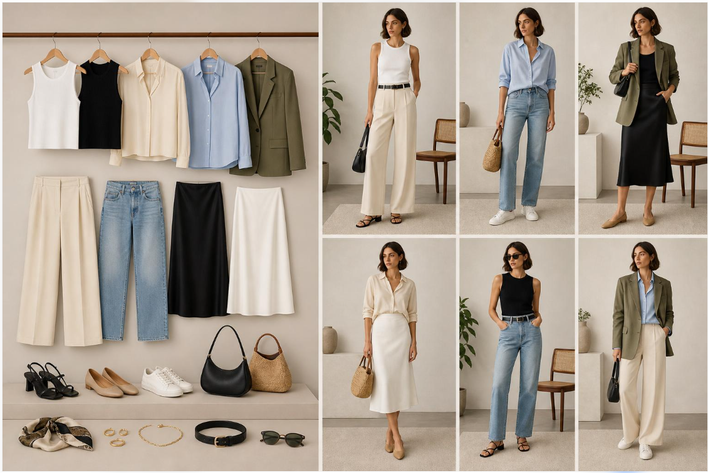
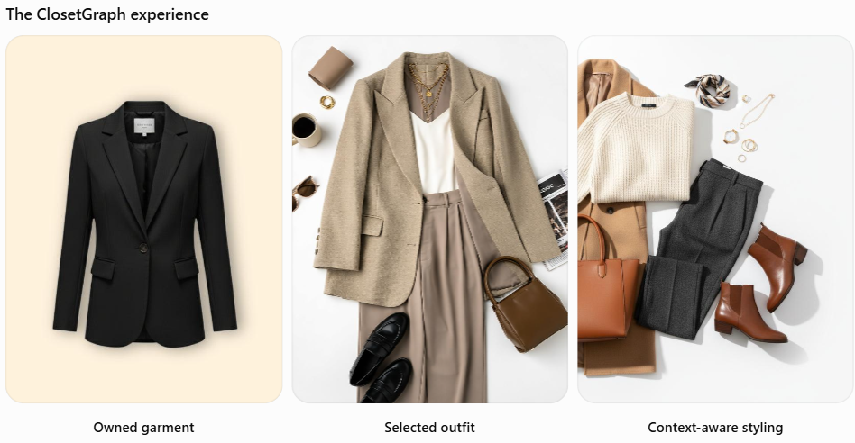
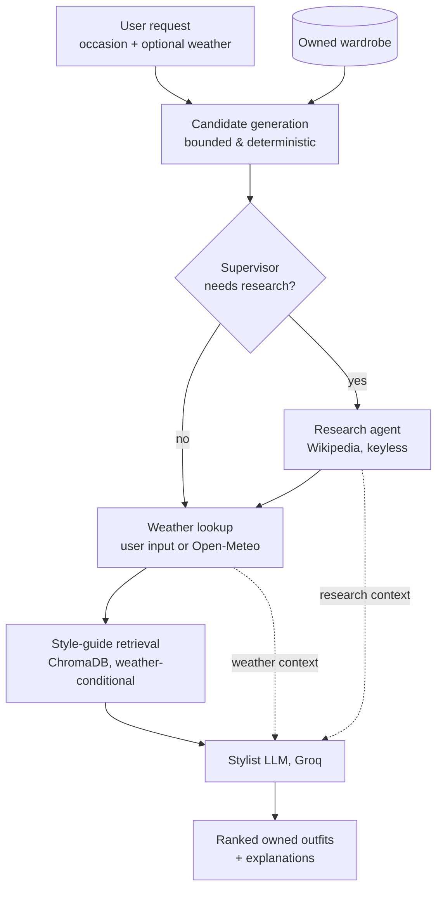

# ClosetGraph

**An AI stylist that understands your wardrobe, not just your prompt.**



ClosetGraph generates and ranks complete outfits from clothes you actually own, combining compositional styling reasoning, retrieved fashion knowledge, occasion constraints, real-world weather, and on-demand research for unfamiliar dress codes.

The hard part isn't labeling a shirt "casual." It's judging a *complete outfit*: a tank reads business-casual under a tailored blazer, tailored trousers move from office to dinner depending on the top, and a trench earns its place only when it's cold. ClosetGraph is built around that compositional judgment, over clothes the user owns.

---

## See It in Action

**Request:** `outdoor market trip` with weather `11 degrees celsius, rainy`

**ClosetGraph's top recommendation** (real output, full 20-candidate ranking):

> **grey oversized graphic tee, relaxed straight-leg denim, black rain jacket, grey wool scarf**
> *"...combine to provide waterproof coverage, warmth, and a casual yet polished look suitable for a rainy market trip."*

The weather pulled a rain jacket and scarf into the top pick, and the reasoning explains why without being told which items to use.

**Context-sensitivity (verified controlled test).** For the *same* `weekend walk` occasion, only the weather changes:

| Weather | Camel wool trench in the top outfit? |
| --- | --- |
| `2 degrees celsius, cold` | **Yes**, the outer layer earns its place |
| `27 degrees celsius, sunny` | **No**, dropped as overkill |

Weather never overrides the occasion: for a cold `client meeting`, a warm-but-casual hoodie outfit still loses to the professional one. Dress code holds; weather only reorders the suitable options.

**Unfamiliar occasions.** When a request names a venue or event whose dress code is not general knowledge (a members-only club code, a published enclosure code), a supervisor routes it to a research step that looks the code up and feeds the constraint to the stylist, so the recommendation and its explanation reflect what the occasion actually requires.

---

## How It Works

From an owned garment, to a selected outfit, to context-aware styling:



Under the hood, that is a LangGraph pipeline:



Deterministic candidate generation feeds a supervisor that decides, with a cheap deterministic skip plus an LLM classifier only for ambiguous cases, whether the occasion needs research. The weather step is skipped with no API call when no weather is given, then category-stratified RAG runs, then a single Groq-backed stylist ranks and explains. Hard constraints (ownership, outfit structure) are checked in Python; nuanced suitability is left to the model; research and weather inform the ranking but never override the occasion or owned-wardrobe limits.

---

## Core Capabilities

**Wardrobe-grounded recommendations.** Only ever recommends items the user owns. A deterministic validator enforces ownership and outfit structure (one top, one bottom, no duplicates) on every output.

**Compositional styling.** Reasons about complete combinations including layering, effective formality, coverage, and color cohesion rather than labeling single garments.

**Retrieval-augmented styling.** A custom style-guide corpus (5 documents, 28 sections) is indexed in ChromaDB and retrieved per category (occasion, layering, garments, color), so the stylist reasons with grounded fashion principles.

**Weather-aware recommendations.** Accepts explicit temperature/condition or resolves a live forecast from a city via Open-Meteo (keyless). User input takes precedence; a lookup fills only the missing fields; provenance is tracked per field; a failed lookup degrades gracefully without fabricating weather.

**Research for unfamiliar occasions.** A supervisor routes occasions whose dress code is not inferable (a named club code, a published enclosure code) to a research agent that fetches Wikipedia (keyless) and distills it into a styling constraint with its source. Deciding when to research is a knowledge-gap judgment, so it uses a hybrid of deterministic triggers and an LLM classifier; a failed lookup degrades gracefully.

**Evaluation and observability.** A typed golden set, controlled pairwise comparisons, an isolated supervisor routing benchmark, an LLM-as-judge for subjective cases, and Langfuse tracing on every model call.

---

## Evaluation & Reliability

Evaluation separates concerns that are easy to conflate: ranking quality, candidate coverage, structural correctness, routing accuracy, and LLM execution reliability. Each is measured and reported on its own.

| Dimension | Result |
| --- | --- |
| Ranking quality (applicable checks) | **12/12 passed (100%)**, 0 failures |
| Structural correctness | **0 violations** across all outputs |
| Candidate coverage | **~86%**; 2 checks referenced combinations the bounded pool did not generate, reported as *inapplicable*, not failed |
| Weather context-reversal | **4/4** ranking correct, **4/4** reasoning garment-consistent |
| Supervisor routing | **72% to 90%** across benchmark iterations (29 labeled cases), decision accuracy and reason quality reported separately |
| Test suite | **91 passing** (mocked; no live Groq or network in tests) |
| Run cost | **$0** on Groq, Open-Meteo, and local ChromaDB free tiers |

> **100% applicable ranking success is not 100% general accuracy.** It means every ranking check that *could* run on the generated candidates passed. Coverage (what the bounded pool let us test) is reported separately and honestly.

**Controlled, one-variable tests.** A weather context-reversal holds the two outfits and occasion fixed and varies only the weather, so a ranking change is attributable to weather, not prompt noise (a trench ranks in at 2 degrees and drops at 27). The supervisor is evaluated in isolation against an independently-labeled benchmark: when the first run scored 72%, every failure was inspected individually, and accuracy rose to 90% by fixing the classifier, not by relabeling cases to pass. The stylist is tested with versus without a verified research constraint to confirm it uses the constraint, and with irrelevant research to confirm it is not derailed.

Methodology, metrics, the 20B-vs-120B model comparison, routing eval versions, and known limitations: **[docs/eval-results.md](docs/eval-results.md)**. Engineering lessons from building the evaluation: **[docs/evaluation_lessons.md](docs/evaluation_lessons.md)**.

### Observability

Every model call is traced to Langfuse (free tier, zero cost):


---

## Quickstart

**Prerequisites:** Python 3.14 and a free [Groq](https://console.groq.com) API key. A free [Langfuse](https://cloud.langfuse.com) project is optional (tracing self-disables without keys).

```bash
# 1. Install dependencies
python -m venv .venv && . .venv/Scripts/activate   # Windows; use source .venv/bin/activate on macOS/Linux
pip install -r requirements.txt

# 2. Configure secrets (never commit these)
#    .env:
#      GROQ_API_KEY=...
#      LANGFUSE_PUBLIC_KEY=...   # optional
#      LANGFUSE_SECRET_KEY=...   # optional

# 3. Build the local style-guide index (required before first run)
python -m closetgraph.indexing

# 4. Run the demo notebook
jupyter lab run_demo.ipynb

# 5. Run the test suite
python -m pytest
```

**Try real weather** (resolves a live forecast from a city name):

```python
from dotenv import load_dotenv; load_dotenv()
import json; from pathlib import Path
from closetgraph.graph import build_graph
from closetgraph.models import WardrobeItem, WeatherInput

wardrobe = [WardrobeItem(**i) for i in json.loads(Path("docs/wardrobe.json").read_text())]
result = build_graph().invoke({
    "wardrobe": wardrobe,
    "occasion": "outdoor afternoon market",
    "candidate_outfits": [], "ranked_outfits": [],
    "weather_input": WeatherInput(location="Chicago"),
})
print(result["weather_context"])
for o in result["ranked_outfits"][:5]:
    print(o.rank, o.items, "::", o.reasoning)
```

**Evaluations** run through `scripts/run_evals.py` (golden, pairwise, weather, routing, and research suites), writing a JSON report.

Notes:
- The ChromaDB index is generated locally and gitignored, so rebuild it after cloning and whenever the styling corpus changes (`python -m closetgraph.indexing`).
- Live Groq evaluations consume free-tier tokens and can hit daily rate limits; the eval runner throttles and isolates per-case failures so one bad call doesn't abort a run.

---

## Engineering Decisions

- **Bounded, deterministic candidate generation** instead of the full Cartesian product, which keeps the stylist prompt small and reproducible as the wardrobe grows while preserving compositional reasoning over a curated pool (plus deterministic accessory variants).
- **Hard constraints in Python, suitability in the LLM.** Ownership and outfit structure are objective and cheap to verify deterministically; nuanced styling is where the model earns its place.
- **Conditional RAG.** Weather guidance is retrieved only when a request actually has weather, so indoor and no-weather runs stay identical to the baseline and prompts stay lean.
- **Deterministic weather gating, LLM routing only for research.** Whether weather applies is a data-availability check done in code. Whether an occasion needs research is a knowledge-gap judgment, so that one decision uses an LLM; both avoid letting a router do the stylist's job.
- **Provenance-aware context and graceful failure.** Resolved weather and research record where each piece came from (user, forecast, or source URL); a failed lookup surfaces an error and continues rather than inventing conditions.
- **Honest coverage over passing fixtures.** Candidate sampling is seeded only for reproducibility, never tuned to make checks pass; routing labels were set independently and failures were fixed in the classifier, not the benchmark.

The reasoning behind these, with the failures that motivated them, is written up in **[docs/evaluation_lessons.md](docs/evaluation_lessons.md)**.

---

## Roadmap

Implemented and evaluated: wardrobe-grounded recommendations, compositional styling, style-guide RAG, weather context, and a supervisor-routed research agent for unfamiliar dress codes.

Planned, not yet built:

- **Date and time-aware forecasts**: future-dated and time-of-day weather
- **Vision-based wardrobe ingestion**: add items from photos
- **Preference memory**: durable user style preferences
- **UI and deployment**: a usable app on free hosting

Full staged plan: **[roadmap.md](roadmap.md)**.

---

## Documentation

| Doc | What's in it |
| --- | --- |
| [roadmap.md](roadmap.md) | Staged development plan and status |
| [docs/eval-results.md](docs/eval-results.md) | Evaluation metrics, model comparison, routing eval versions, limitations |
| [docs/evaluation_lessons.md](docs/evaluation_lessons.md) | Engineering lessons from building the evals |
| [docs/research-lookup-design.md](docs/research-lookup-design.md) | Research agent design |
| [design notes (PDF)](docs/handwritten_notes_updated.pdf) | Early architecture and open questions |

Built as a portfolio project exploring compositional, retrieval-grounded, weather-aware, research-augmented outfit reasoning on a strict free-tier budget.
