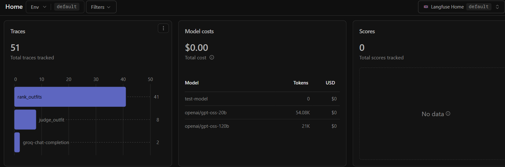

# ClosetGraph

ClosetGraph is a wardrobe intelligence project that recommends complete outfits from a user's own closet for real occasions like client meetings, dinners, interviews, and casual events.

The project is being built as a notebook-first LangGraph system for the Hugging Face Agents Course final project. The goal is not just to label clothing as casual or formal. ClosetGraph should reason about how garments work together: layering, coverage, color, texture, dress-code range, weather, and context.

## Why It Is Interesting

A blazer does not automatically make every outfit professional. A tank can become business casual under the right layer. Tailored trousers can shift from office to dinner depending on the top and styling. ClosetGraph is designed around that kind of compositional outfit reasoning.

## Planned System

- LangGraph orchestration with a supervisor and specialist agents where justified.
- Persistent wardrobe memory separate from session conversation memory.
- Style-guide RAG over a custom styling corpus.
- Candidate outfit generation using only owned items.
- Deterministic validation for hard constraints like ownership.
- Model reasoning for nuanced outfit suitability and ranking.
- Groq as the primary free hosted model path, with Ollama as a local fallback.
- Later support for weather context, web research, photo-based wardrobe entry, tracing, evals, UI, and Hugging Face Spaces deployment.

## Current Status

ClosetGraph is being developed incrementally. Stages 1 and 2 are complete.

**Stage 1 (walking skeleton):** a notebook demo (`run_demo.ipynb`) loads a small wardrobe, generates owned-item outfit candidates, and ranks them with a Groq-backed stylist, with a pytest suite over the core graph and stylist.

**Stage 2 (Style Guide RAG and Evals):**
- Style-guide RAG: a local Chroma index over a custom styling corpus, with stratified per-category retrieval wired into the stylist prompt.
- A deterministic validity checker for hard constraints (ownership, outfit structure).
- An evaluation harness (`closetgraph/eval_harness.py`) over a 24-case golden set, separating hard constraints, ranking preferences, and behavioral expectations; pairwise compositional suitability tests with context reversal; and an LLM-as-judge for subjective color-cohesion cases.
- Langfuse tracing around every model call. Findings, metrics, and a 20B-vs-120B model comparison are in [docs/eval-results.md](docs/eval-results.md).

### Observability

Every model call is traced to Langfuse on the free tier (zero cost):

## Running It

- **Demo:** open `run_demo.ipynb` on the project virtualenv kernel to see ranked outfits and the retrieved style guidance for several occasions. Build the retrieval index once first with `python -m closetgraph.indexing`.
- **Evaluation:** the harness in `closetgraph/eval_harness.py` runs the golden set (`run_golden_set`) and pairwise tests (`run_pairwise_set`) programmatically. These make live Groq calls, so throttle for the free-tier rate limit.

The initial handwritten design notes capture the early architecture, open questions, and decisions that shaped the roadmap:

[View initial design notes](docs/handwritten_notes_updated.pdf)

See [roadmap.md](roadmap.md) for the staged development plan.
