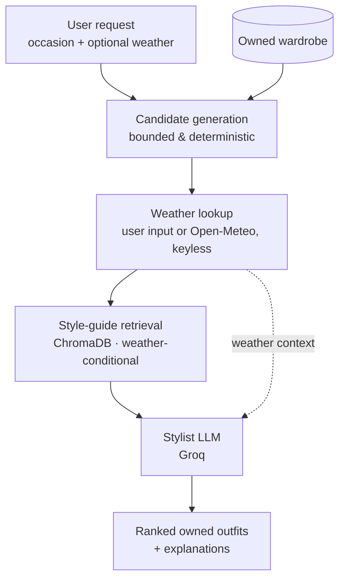

# ClosetGraph

**An AI stylist that understands your wardrobe, not just your prompt.**

ClosetGraph generates and ranks complete outfits from clothes you actually own, combining compositional styling reasoning, retrieved fashion knowledge, occasion constraints, and real-world weather.

The hard part isn't labeling a shirt "casual." It's judging a *complete outfit*: a tank reads business-casual under a tailored blazer, tailored trousers move from office to dinner depending on the top, and a trench earns its place only when it's cold. ClosetGraph is built around that compositional judgment, over clothes the user owns.

---

## See It in Action

**Request:** `outdoor market trip` · weather `11 degrees celsius, rainy`

**ClosetGraph's top recommendation** (real output, full 20-candidate ranking):

> **grey oversized graphic tee · relaxed straight-leg denim · black rain jacket · grey wool scarf**
> *"...combine to provide waterproof coverage, warmth, and a casual yet polished look suitable for a rainy market trip."*

The weather pulled a rain jacket and scarf into the top pick and the reasoning explains why without being told which items to use.

**Context-sensitivity (verified controlled test).** For the *same* `weekend walk` occasion, only the weather changes:

| Weather | Camel wool trench in the top outfit? |
| --- | --- |
| `2 degrees celsius, cold` | **Yes** — the outer layer earns its place |
| `27 degrees celsius, sunny` | **No** — dropped as overkill |

And weather never overrides the occasion: for a cold `client meeting`, a warm-but-casual hoodie outfit still loses to the professional one. Dress code holds; weather only reorders the suitable options.

---

## How It Works



A LangGraph pipeline: deterministic candidate generation feeds a weather step (skipped with no API call when no weather is given), then category-stratified RAG, then a single Groq-backed stylist that ranks and explains. Hard constraints (ownership, outfit structure) are checked in Python; nuanced suitability is left to the model.

---

## Core Capabilities

**Wardrobe-grounded recommendations.** Only ever recommends items the user owns. A deterministic validator enforces ownership and outfit structure (one top, one bottom, no duplicates) on every output.

**Compositional styling.** Reasons about complete combinations including layering, effective formality, coverage, and color cohesion rather than labeling single garments.

**Retrieval-augmented styling.** A custom style-guide corpus (5 documents, 28 sections) is indexed in ChromaDB and retrieved per category (occasion, layering, garments, color), so the stylist reasons with grounded fashion principles.

**Weather-aware recommendations.** Accepts explicit temperature/condition or resolves a live forecast from a city via Open-Meteo (keyless). User input takes precedence; a lookup fills only the missing fields; provenance is tracked per field; a failed lookup degrades gracefully without fabricating weather. Weather influences ranking but never overrides the occasion.

**Evaluation and observability.** A typed golden set, controlled pairwise comparisons, an LLM-as-judge for subjective cases, and Langfuse tracing on every model call.

---

## Evaluation & Reliability

Evaluation separates four things that are easy to conflate — ranking quality, candidate coverage, structural correctness, and LLM execution reliability.

| Dimension | Result |
| --- | --- |
| Ranking quality (applicable checks) | **12/12 passed (100%)**, 0 failures |
| Structural correctness | **0 violations** across all outputs |
| Candidate coverage | **~86%** — 2 checks referenced combinations the bounded pool did not generate, reported as *inapplicable*, not failed |
| Weather context-reversal | **4/4** ranking correct, **4/4** reasoning garment-consistent |
| LLM execution | 2/30 cases returned empty output (reasoning exceeded the token budget); root-caused and addressed by raising the completion budget 4096 → 5000 |
| Test suite | **69 passing** (mocked; no live Groq or network in tests) |
| Run cost | **$0** — Groq, Open-Meteo, and local ChromaDB free tiers |

> **100% applicable ranking success is not 100% general accuracy.** It means every ranking check that *could* run on the generated candidates passed. Coverage (what the bounded pool let us test) is reported separately and honestly. The two empty responses were fixed on the affected cases by raising the token budget; a full 30-case revalidation at the new budget is still pending.

**A controlled context-reversal test** holds the two outfits and occasion fixed and varies only the weather — so a ranking change is attributable to weather, not to prompt noise. Example: a camel wool trench ranks into the top outfit at 2°C and drops at 27°C; a professional outfit stays preferred for a cold client meeting over a warmer, more casual one.

Methodology, metrics, the 20B-vs-120B model comparison, and known limitations: **[docs/eval-results.md](docs/eval-results.md)**. Engineering lessons from building the evaluation: **[docs/evaluation_lessons.md](docs/evaluation_lessons.md)**.

### Observability

Every model call is traced to Langfuse (free tier, zero cost):


---

## Quickstart

**Prerequisites:** Python 3.14, a free [Groq](https://console.groq.com) API key. A free [Langfuse](https://cloud.langfuse.com) project is optional (tracing self-disables without keys).

```bash
# 1. Install dependencies
python -m venv .venv && . .venv/Scripts/activate   # Windows; use source .venv/bin/activate on macOS/Linux
pip install -r requirements.txt

# 2. Configure secrets (never commit these)
#    .env:
#      GROQ_API_KEY=...
#      LANGFUSE_PUBLIC_KEY=...   # optional
#      LANGFUSE_SECRET_KEY=...   # optional

# 3. Build the local style-guide index (required before first run)
python -m closetgraph.indexing

# 4. Run the demo notebook
jupyter lab run_demo.ipynb

# 5. Run the test suite
python -m pytest
```

**Try real weather** (resolves a live forecast from a city name):

```python
from dotenv import load_dotenv; load_dotenv()
import json; from pathlib import Path
from closetgraph.graph import build_graph
from closetgraph.models import WardrobeItem, WeatherInput

wardrobe = [WardrobeItem(**i) for i in json.loads(Path("docs/wardrobe.json").read_text())]
result = build_graph().invoke({
    "wardrobe": wardrobe,
    "occasion": "outdoor afternoon market",
    "candidate_outfits": [], "ranked_outfits": [],
    "weather_input": WeatherInput(location="Chicago"),
})
print(result["weather_context"])
for o in result["ranked_outfits"][:5]:
    print(o.rank, o.items, "::", o.reasoning)
```

**Evaluations** run through `scripts/run_evals.py` (golden / pairwise / weather suites, writing a JSON report).

Notes:
- The ChromaDB index is generated locally and gitignored and must be rebuilt after cloning and whenever the styling corpus changes (`python -m closetgraph.indexing`).
- Live Groq evaluations consume free-tier tokens and can hit daily rate limits; the eval runner throttles and isolates per-case failures so one bad call doesn't abort a run.

---

## Engineering Decisions

- **Bounded, deterministic candidate generation** instead of the full Cartesian product it keeps the stylist prompt small and reproducible as the wardrobe grows, while preserving compositional reasoning over a curated pool (plus deterministic accessory variants).
- **Hard constraints in Python, suitability in the LLM.** Ownership and outfit structure are objective and cheap to verify deterministically; nuanced styling is where the model earns its place.
- **Conditional RAG.** Weather guidance is retrieved only when a request actually has weather, so indoor and no-weather runs stay identical to the baseline and prompts stay lean.
- **Deterministic weather gating, not an LLM router.** "Do we have weather?" is a data-availability check (code). "Does it change the outfit?" is a judgment (the stylist). No extra LLM call, no routing nondeterminism.
- **Provenance-aware context and graceful failure.** Resolved weather records whether each field came from the user or the forecast; a failed lookup surfaces an error and continues rather than inventing conditions.
- **Honest coverage over passing fixtures.** Candidate sampling is seeded only for reproducibility, never tuned to make checks pass; unreachable checks are reported as *inapplicable*, and coverage is a first-class metric.

The reasoning behind these (with the failures that motivated them) is written up in **[docs/evaluation_lessons.md](docs/evaluation_lessons.md)**.

---

## Roadmap

Current: wardrobe-grounded recommendations, compositional styling, style-guide RAG, and weather context are implemented and evaluated. Planned, not yet built:

- **Research agent**: look up unfamiliar venues and dress codes, summarized into styling constraints ([design note](docs/research-lookup-design.md))
- **Date/time-aware forecasts**: future-dated and time-of-day weather
- **Vision-based wardrobe ingestion**: add items from photos
- **Preference memory**: durable user style preferences
- **UI and deployment**: a usable app on free hosting

Full staged plan: **[roadmap.md](roadmap.md)**.

---

## Documentation

| Doc | What's in it |
| --- | --- |
| [roadmap.md](roadmap.md) | Staged development plan and status |
| [docs/eval-results.md](docs/eval-results.md) | Evaluation metrics, model comparison, limitations |
| [docs/evaluation_lessons.md](docs/evaluation_lessons.md) | Engineering lessons from building the evals |
| [docs/research-lookup-design.md](docs/research-lookup-design.md) | Design for the planned research agent |
| [design notes (PDF)](docs/handwritten_notes_updated.pdf) | Early architecture and open questions |

Built as a portfolio project exploring compositional, retrieval-grounded, weather-aware outfit reasoning on a strict free-tier budget.
